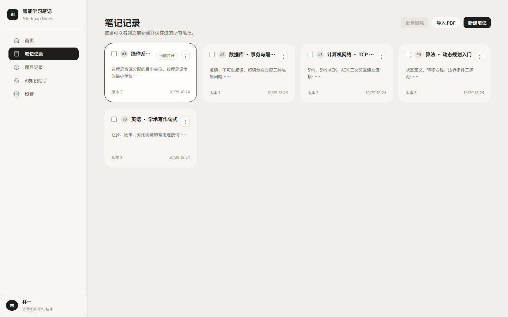
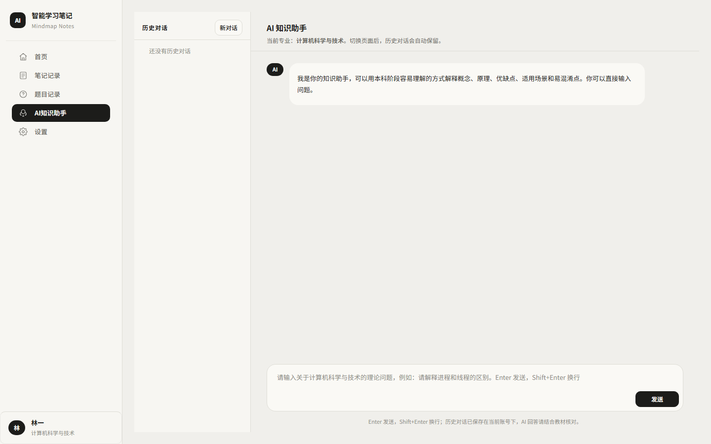
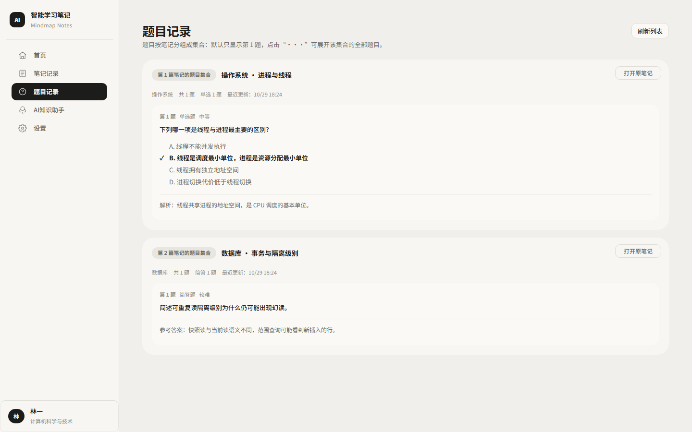
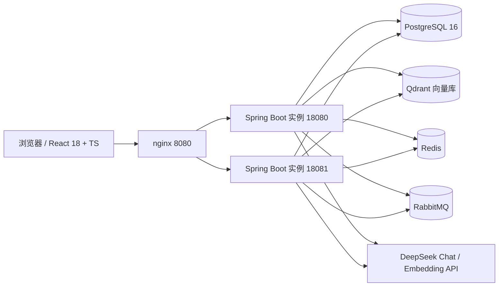

# AI 智能思维导图学习系统 · 学习 Agent

> 一边写 Markdown 笔记，一边自动生成思维导图；再配一个能检索你自己笔记、带长期记忆和引用来源的学习 Agent。

一个个人独立开发的全栈项目：**Spring Boot 3 + Spring AI + PostgreSQL + Qdrant + React**。
目标不是"再做一个聊天框"，而是把 **LLM 的不可信输出** 和 **真实学习资料** 用工程手段接起来：
结构化增量同步、RAG 检索、工具调用、长期记忆、证据引用、异步任务与可观测性。



> 界面截图为演示数据。

---

## 功能

- **Markdown → 思维导图增量同步**：标题/列表走本地规则，普通段落交给大模型归纳；只对变化的块调用 AI。
- **学习 Agent（工具调用）**：6 个只读工具，模型自主决定是否检索笔记、导图、题目、长期记忆；用户身份通过 `ToolContext` 透传，工具签名不含 `userId`。
- **RAG 检索**：Qdrant 向量库 + 自研 Markdown 分块；检索结果带来源、相似度和证据编号，回答按证据标注引用。
- **长期记忆与会话摘要**：6 类记忆（偏好/薄弱点/目标等）、显式记忆识别、语义去重合并、跨会话注入；长对话异步增量摘要。
- **题目生成**：按思维导图节点生成单选/简答，异步任务 + 状态机，AI 初稿标记为待确认。
- **PDF 导入**：PDFBox 解析、文件头校验、大小/页数限制、扫描件识别、字号启发式生成 Markdown 草稿。
- **工程可靠性**：Flyway 迁移、乐观锁、用户数据隔离、JWT/JWE、MQ + Outbox、SSE 流式、限流、Prometheus 指标。
- **大文档保护**：JSON Mode + 分批 + 16 条业务校验；超宽文档做**节点预算与折叠**（实测 248 → 200，折叠文本保留在父节点摘要）。

| AI 助手 | 题目 |
|---|---|
|  |  |

---

## 架构



- **同步链路**：Markdown 解析 → 块级 diff → 规则操作 → 必要时 AI 归纳 → 校验 → 预览 → 用户确认后发布。
- **Agent 链路**：意图分类 → 工具调用 / 迷你 Plan → 证据收集 → 流式回答 → 引用自检。
- **异步链路**：同步、出题、摘要、向量索引走 MQ + Outbox；失败按可重试/配置类分级处理。

---

## 技术栈

**后端**：Java 21、Spring Boot 3.4、Spring AI 1.0、Spring Security、Spring Data JPA、Flyway、PostgreSQL、Qdrant（gRPC）、RabbitMQ、Redis、SSE、虚拟线程、Testcontainers

**前端**：React 18、TypeScript、Vite、React Flow、ELK.js、CodeMirror 6、Zustand

**AI**：DeepSeek（OpenAI 兼容协议）、阿里云 text-embedding-v3、JSON Mode、Tool Calling、RAG

---

## 目录结构

```
mindmap-backend/        Spring Boot 后端（src/main、src/test）
mindmap-frontend/       React + Vite 前端
docs/                  设计文档、评测报告、截图
samples/               示例 Markdown（含宽文档 248 节点样本）
```

---

## 快速开始

### 依赖

- JDK 21、Maven 3.9+
- PostgreSQL 16（Flyway 自动建表）
- Qdrant（gRPC 6334）
- Redis、RabbitMQ（可关，`APP_MQ_ENABLED=false` 时走 @Async 兜底）
- 一个 OpenAI 兼容的对话模型 + 一个 embedding 服务

### 后端

```powershell
cd mindmap-backend
mvn spring-boot:run
```

至少需要设置：

```text
DB_URL=jdbc:postgresql://localhost:5432/aimindmap
DB_USERNAME=postgres
DB_PASSWORD=<your-password>
AI_API_KEY=<your-llm-api-key>
AI_BASE_URL=https://api.deepseek.com
AI_MODEL=deepseek-chat
EMBEDDING_API_KEY=<your-embedding-api-key>
QDRANT_HOST=127.0.0.1
QDRANT_GRPC_PORT=6334
```

> `mindmap-backend/config/application.yml` 是本地真实密钥覆盖文件，已被 `.gitignore` 排除。
> 仓库里的 `src/main/resources/application.yml` 只含占位符和默认值。

### 前端

```powershell
cd mindmap-frontend
npm install
npm run dev
```

默认 Vite 开发端口，API 走 `/api` 代理。

### 测试

```powershell
mvn.cmd -f mindmap-backend/pom.xml -B test
cd mindmap-frontend
npm run build
```

当前基线：**1154 个测试全绿 / Skipped 4**（需要 Docker 跑 Testcontainers）。

---

## 评测与当前状态

### 已完成

- **P0 Agent 评测集**：50 条，覆盖单跳、多跳、导图、题目、记忆、拒答、闲聊、注入。
- 最终结果：**50/50 PASS**；工具选择 F1 **0.7921**、引用覆盖率 **0.4327**、拒答 **1.0**、闲聊零调用 **1.0**、P95 **10.96s**、非法引用 **0**。
- P1 能力（意图路由、零调用补检、迷你 Plan、引用自检、检索多查询/RRF、记忆相关性、证据注入防护）已实现并有单测。
- 大文档节点预算：248 → 200，折叠 48 项到 14 个父节点摘要。

### 诚实说明（不写没跑过的数字）

- P0 的 **F1 与引用覆盖率两项门槛未达**（目标 F1 ≥0.85、覆盖率 ≥85%），不宣称达标。
- P1 的端到端效果**还没有统一评测数字**（P1-F 未跑），只有机制级单测与两轮检索专项测量。
- 有一次真环境 + 真 DeepSeek 的宽文档验收：**200 节点 / 48 项折叠 / 36 个 AI 节点**。

详见：[P0 总验收](docs/P0-总验收记录-20261026.md)、[P1 总汇报](docs/P1-总汇报-20261028.md)、[节点预算与折叠完成汇报](docs/思维导图节点预算与折叠完成汇报-20261104.md)。

---

## 工程亮点

1. **工具安全边界**：`userId` 不进模型参数，只从 `ToolContext` 读取；读取类工具强制归属校验；单轮调用上限、结果截断、单轮缓存、逐次落库。
2. **大文档不整单失败**：深度裁剪 + 节点预算 + 折叠，保证 `add_node ≤ 200`；超宽列表折进父节点摘要，而不是删内容。
3. **异步向量索引**：`FOR UPDATE SKIP LOCKED` 认领、确定性 pointId 幂等、内容哈希未变跳过、失败指数重试、事务提交后写向量。
4. **LLM 输出可靠性**：JSON Mode、临时 ID、16 条业务校验、按段落分批、截断检测、失败不发布半成品。
5. **上下文预算**：token 估算 + 动态输出上限 + 真实 usage 校准；长会话摘要 + 最近消息窗口。
6. **可观测性**：`agent_runs` / `agent_tool_calls` / `agent_steps` / `agent_evidence` 全链路落库；SSE 推送工具调用过程。

---

## 已知限制

- 单 Agent、只读工具；没有多 Agent 协作，也没有让模型直接写数据库。
- P1 端到端效果尚未统一评测（P1-F 未跑）。
- 宽文档折叠后的文本在父节点 `summary` 里（悬停可见），节点框内不展开。
- 没有一键 Docker Compose / 在线 Demo；需要自备 PostgreSQL、Qdrant、Redis、RabbitMQ。
- 项目定位是个人学习与求职作品，不是生产级 SaaS。

---

## AI 辅助开发说明

本项目全程使用 **Codex / Claude Code** 辅助编码，但不是"让 AI 随便写"：

- 先写实施方案，再按阶段开发；每阶段有验收标准与真实测试结果；
- 约束"测试只增不减、表结构只走 Flyway、不改契约、密钥不落库"；
- 架构取舍、提示词、代码审查与验收由作者完成。

这套"AI 提效 + 人工把关 + 分阶段验收"的流程，本身也是项目的一部分。

---

## 文档

- [系统实施方案 v1.1](docs/AI智能思维导图系统-实施方案-v1.1.md)
- [学习 Agent 综合升级方案](docs/学习Agent综合升级方案-上下文工程与高并发-v1.0.md)
- [P0 总验收记录](docs/P0-总验收记录-20261026.md)
- [P1 总汇报](docs/P1-总汇报-20261028.md)
- [思维导图节点预算与折叠方案](docs/思维导图节点预算与折叠实施方案-v1.0.md)
- [节点超限诊断](docs/思维导图节点超限诊断-20261103.md)
- [验收数据清理记录](docs/验收数据清理记录-20261112.md)
- [Agent 评测报告](docs/agent-eval/2026-10-26-final.md)

---

## License

未指定开源协议。如需引用或二次开发，请先联系作者。
